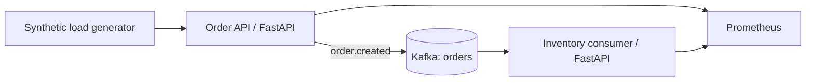

# Architecture and decisions

## Purpose
An intentionally small event-driven order pipeline used to investigate distributed failure modes. All data is synthetic; this is not an ecommerce product or a payment system.

## ADR-001: Kafka between services
**Decision:** decouple order acceptance from inventory processing using Kafka. **Why:** expose consumer lag, duplicate delivery, broker outages and asynchronous failure propagation. **Cost:** eventual consistency, offset management and additional operational complexity.

## ADR-002: Local-first Compose
**Decision:** Docker Compose with one Kafka broker. **Why:** reproducible on a laptop. **Cost:** no high availability, not production representative for broker failover.

## ADR-003: HTTP acceptance semantics
**Decision:** return HTTP 202 only after Kafka acknowledges the event. **Why:** avoid claiming acceptance when the broker is unavailable. **Cost:** synchronous dependency on broker health; producer construction per request is deliberately simple and inefficient.

## Next steps
Durable idempotency, explicit topic creation, consumer lag metrics, Grafana dashboards, tracing, Toxiproxy, failure injection, and systematic performance comparisons.
